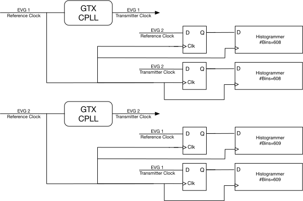
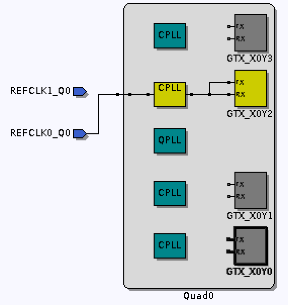
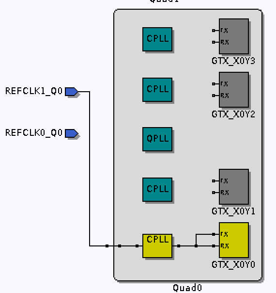

# Dual Event Generator — Firmware

> [!NOTE]
> **dual-evg docs:** [Overview](README.md) · [Hardware](Hardware.md) · [Firmware](Firmware.md) · [Updating Firmware](HowtoUpdateFirmware.md) · [Bringing Up a New Board](BringingUpNewBoard.md)<br>
> **Related projects:** [EPICS support module ↗](https://git.als.lbl.gov/accelerator-controls/epics/iocs/DualEventGeneratorSupport/-/blob/HEAD/documentation/README.md) · [Timing IOC ↗](https://git.als.lbl.gov/accelerator-controls/epics/iocs/siocDualTiming/-/blob/HEAD/documentation/README.md)

The firmware lives in the `dual-evg` repository: gateware under `gateware/`, µBlaze software under `software/`. The production build target is **`devg_marble`** (`APP=devg`, `PLATFORM=marble`).

To keep the FPGA as responsive as possible to EPICS IOC requests, the firmware provides **two µBlaze processors**:

| Processor | Source | Responsibilities |
|:---:|---|---|
| 0 | `software/src/proc_0` | Console, front-panel display, flash memory, TFTP file handling, coincidence measurement |
| 1 | `software/src/proc_1` | Network stack, EPICS communication (command server and sequencer status publisher), time of day (NTP/GPS), sequencers, MGT management |

## Contents

- [Configuration Parameters](#configuration-parameters)
- [Clock Synchronization](#clock-synchronization)
- [Special Event Codes](#special-event-codes)
- [Event Source Precedence](#event-source-precedence)
- [Distributed Data Bus](#distributed-data-bus)
- [Time Providers](#time-providers)
- [Network Services](#network-services)
- [TFTP Server](#tftp-server)
- [Setting Network Parameters](#setting-network-parameters)
- [Console Commands](#console-commands)
- [Building](#building)
- [Deploying over JTAG](#deploying-over-jtag)
- [Scripts](#scripts)

---

## Configuration Parameters

Parameters shared between software and gateware are defined in `software/target/<APP>_<PLATFORM>/config.h`. The build converts every `CFG_*` definition into a Verilog parameter automatically (`gateware/scripts/createVerilogIDX.sh` runs as part of `make`), so a change only requires a rebuild.

### General

| Parameter | Value | Description |
|---|--:|---|
| `CFG_MINIMUM_INJECTION_CYCLE_MS` | 990 | Lower limit on the time (ms) between injection cycle requests. The cycle time is set by the first line of [`DefaultSequence.csv`](#defaultsequencecsv-format). |
| `CFG_MAXIMUM_INJECTION_CYCLE_MS` | 2010 | Upper limit on the time (ms) between injection cycle requests. |
| `CFG_HARDWARE_TRIGGER_COUNT` | 8 | Hardware triggers per generator. Only the first six are wired on the EVIO card and rear panel. |
| `CFG_EVIO_DIAG_IN_COUNT` | 1 | Diagnostic inputs per FMC card. |
| `CFG_EVIO_DIAG_OUT_COUNT` | 2 | Diagnostic outputs per FMC card. |
| `CFG_EVIO_FMC_COUNT` | 2 | Number of EVIO FMC cards. |
| `CFG_EVIO_FIREFLY_COUNT` | 6 | Number of Firefly transceiver sites. |
| `CFG_FAN_COUNT` | 4 | Number of monitored fans. |
| `CFG_SEQUENCE_RAM_CAPACITY` | 1024 | Size of the event sequence RAM. Long intervals between events consume more than one entry, so the actual maximum sequence length may be smaller. |
| `CFG_EVENT_CAT_NUM` | 4 | Number of event categories. |
| `CFG_MGT_FMC_OR_QSFP` | 0 | Bank 115 MGTs drive the FMC cards (0) or QSFP 2 (1, used by the `devg_test` targets). |
| `CFG_MGT_TX_REF_ALIGN` | 0 | Software Tx:Ref phase alignment disabled; automatic MGT Tx alignment is used instead. See [Clock Synchronization](#clock-synchronization). |

### EVG1 (injector)

| Parameter | Value | Description |
|---|--:|---|
| `CFG_EVG1_CLK_PER_RF_COINCIDENCE` | 668 | EVG1 reference clocks per RF coincidence interval. |
| `CFG_EVG1_CLK_PER_TICKS_COINCIDENCE` | 167 | EVG1 clocks per coincidence tick (668 ÷ 4). |
| `CFG_EVG1_CLK_PER_BR_AR_ALIGNMENT` | 50768 | EVG1 clocks between BR/AR bucket alignments. |
| `CFG_EVG1_CLK_PER_BR_ORBIT_CLOCK_DIV4` | 125 | EVG1 clocks per four booster orbits. |
| `CFG_EVG1_CLK_PER_BR_AR_COINCIDENCE` | 6346000 | EVG1 clocks between BR/AR orbit coincidences. |
| `CFG_EVG1_CLK_PER_HEARTBEAT` | 126920000 | EVG1 clocks between heartbeat events (20 BR/AR coincidences). |
| `CFG_EVG1_BR_AR_COINC_PER_RF_COINC` | 304 | BR/AR coincidences per RF coincidence. |
| `CFG_EVG1_BR_AR_ALIGN_PER_BR_AR_COINC` | 125 | BR/AR alignments per BR/AR coincidence. |
| `CFG_EVG1_HEARTBEAT_COUNT` | 2 | Number of selectable EVG1 heartbeat settings (ALS-U and ALS). |
| `CFG_EVG1_INJ_MODE_COUNT` | 2 | Number of injection synchronization modes. |
| `CFG_EVG1_ALS_CLK_PER_BR_SR_ALIGNMENT` | 10250 | Alternate BR/SR alignment interval for operation with the existing ALS storage ring. |
| `CFG_EVG1_ALS_CLK_PER_HEARTBEAT` | 124640000 | Alternate heartbeat interval for operation with the existing ALS storage ring. |

### EVG2 (accumulator and storage rings)

| Parameter | Value | Description |
|---|--:|---|
| `CFG_EVG2_CLK_PER_RF_COINCIDENCE` | 669 | EVG2 reference clocks per RF coincidence interval. |
| `CFG_EVG2_CLOCK_PER_AR_ORBIT_CLOCK` | 76 | EVG2 clocks per accumulator ring orbit. |
| `CFG_EVG2_CLOCK_PER_SR_ORBIT_CLOCK` | 82 | EVG2 clocks per storage ring orbit. |
| `CFG_EVG2_CLOCK_PER_AR_SR_COINCIDENCE` | 3116 | EVG2 clocks between AR/SR orbit coincidences. |
| `CFG_EVG2_CLK_PER_HEARTBEAT` | 124640000 | EVG2 clocks between heartbeat events. |

> [!TIP]
> **ALS vs. ALS-U operation is selected at run time**, not by rebuilding. The EPICS records [`INJ:hbSel`](https://git.als.lbl.gov/accelerator-controls/epics/iocs/DualEventGeneratorSupport/-/blob/HEAD/documentation/EPICSnotes.md#injection-alignment-records) (ALS-U 126.92e6 / ALS 124.64e6 heartbeat) and [`INJ:alignSel`](https://git.als.lbl.gov/accelerator-controls/epics/iocs/DualEventGeneratorSupport/-/blob/HEAD/documentation/EPICSnotes.md#injection-alignment-records) (ALS-U BR/AR / ALS BR/SR alignment) choose between the two sets of EVG1 values.

### Timing relationships

$$
T_{\text{coincidence}} = \frac{\texttt{CFG\_EVG1\_CLK\_PER\_RF\_COINCIDENCE}}{F_{\text{REF1}}} = \frac{\texttt{CFG\_EVG2\_CLK\_PER\_RF\_COINCIDENCE}}{F_{\text{REF2}}}
$$

$$
T_{\text{heartbeat1}} = \frac{\texttt{CFG\_EVG1\_CLK\_PER\_HEARTBEAT}}{F_{\text{REF1}}}
\qquad
T_{\text{heartbeat2}} = \frac{\texttt{CFG\_EVG2\_CLK\_PER\_HEARTBEAT}}{F_{\text{REF2}}}
$$

where $F_{\text{REF1}}$ and $F_{\text{REF2}}$ are the reference clock input frequencies, driven at ¼ the rate of the master oscillators for the two frequency domains.

With a storage ring RF of **500.392263 MHz** ($F_{\text{REF2}}$ = 125.098 MHz, so $F_{\text{REF1}}$ = 124.911 MHz):

| Quantity | Value |
|---|---|
| Coincidence interval between domains | ≈ 5.348 µs |
| BR/AR orbit coincidence interval | ≈ 50.80 ms |
| EVG1 heartbeat interval | ≈ 1.016 s |
| EVG2 heartbeat interval | ≈ 0.996 s |

The two heartbeat intervals are **not** the same.

---

## Clock Synchronization

Each event generator is synchronized to the RF master oscillator driving its part of the accelerator. Each master oscillator is divided by 4 and taken to the FPGA over a fiber link. These reference clocks drive an FPGA transceiver reference PLL and a sampling D flip-flop, as shown below.



The rising edge of the sampled signals indicates the phase of the signal relative to the sampling clock. The sampled values update a histogram whose number of bins equals the number of sample clock cycles in the coincidence interval. Sampling both the transceiver reference and the PLL output gives an accurate measurement of each signal's phase relative to the sampling clock — and, by extension, relative to each other.

There are two levels of clock alignment:

**1. Transceiver output vs. transceiver reference.**
Each transceiver output clock drives all logic in its event generator. The output can lock at one of twenty possible phase offsets relative to the incoming reference, chosen randomly when the PLL locks.

- With `CFG_MGT_TX_REF_ALIGN = 1`, the software repeatedly resets the transceiver until it locks at the offset set by the [`pll`](#pll) command.
- With `CFG_MGT_TX_REF_ALIGN = 0` (the current `devg_marble` setting), this loop is bypassed and the transceiver's automatic Tx alignment is used. The phase is still measured, because the coincidence procedure needs it.

The firmware also watches for transceiver loss of lock and resets and realigns the transmitter when it occurs (disable with [debug bit 27](#debug)).

**2. Coincidence between the two RF clock domains.**
The coincidence is the point at which the rising edge of the sampled clock aligns most closely with the rising edge of the FPGA clock, using the D flip-flop sampling logic above. The heartbeat event in each clock domain is aligned with this coincidence.

### Transceiver clock routing

The reference clocks connect to FPGA **bank 115**. The Marble clock crosspoint switch routes:

| Source | Destination |
|---|---|
| `FMC1_GBTCLK0_M2C` (first FMC card) | `MGTREFCLK0_115` |
| `FMC2_GBTCLK0_M2C` (second FMC card) | `MGTREFCLK1_115` |

Transceiver X0Y2 (bank 115 MGT 2) drives the first FMC card and X0Y0 (bank 115 MGT 0) drives the second.

| EVG 1 | EVG 2 |
|:---:|:---:|
|  |  |

📘 Reference: *7 Series FPGAs GTX/GTH Transceivers User Guide (UG476)*

---

## Special Event Codes

| Code | Hex | Meaning |
|--:|:--:|---|
| 0 | `0x00` | Idle — emitted when no other event code request is present |
| 112 | `0x70` | Shift a **0** bit into the event receiver 32-bit time-of-day shift register |
| 113 | `0x71` | Shift a **1** bit into the event receiver 32-bit time-of-day shift register |
| 122 | `0x7A` | Heartbeat |
| 125 | `0x7D` | Pulse-per-second — copies the time-of-day shift register into the receiver time stamp *seconds* and clears the time stamp *tick* counters |
| 127 | `0x7F` | End of sequence table (never emitted; marks the end of a sequence) |

---

## Event Source Precedence

An event code slot can hold at most one event code, so sources are prioritized. When two or more requests occur simultaneously, the highest priority wins. From highest to lowest:

| Priority | Source | Behavior |
|:---:|---|---|
| 1 | **Sequence pattern** | Never omitted or shifted. *Good practice:* leave at least one empty slot between sequence events to minimize shifting of lower-priority events. |
| 2 | **Heartbeat** | Never shifted. If it collides with a sequence pattern event, the heartbeat request is ignored. |
| 3 | **Pulse-per-second** | Delayed to the first free slot after sequence/heartbeat events. |
| 4 | **Hardware trigger** | Delayed to the first free slot after the above. With multiple triggers, the lowest-numbered input wins. |
| 5 | **Software trigger** | Delayed to the first free slot after the above. |
| 6 | **Time-of-day** (POSIX seconds) | Delayed to the first free slot after all others. Harmless as long as all 32 time-of-day events arrive before the next PPS event. |

Slots not used by any of these carry either a periodic K28.5 comma character (at a limited rate) or the idle code.

---

## Distributed Data Bus

Two distributed data bus bits are driven by the event generator firmware:

| Bit | Description |
|:---:|---|
| 0 | One-clock pulse coincident with each heartbeat request, as required by user timing receivers. |
| 1 | One-clock periodic "ping" pulse (nominally ~100 kHz per the source comments) used by the round-trip latency measurement firmware. |
| 2–7 | Unused (always 0). |

---

## Time Providers

During normal operation the event generator tracks time by incrementing the POSIX seconds count each time the pulse-per-second marker is asserted. At startup — and whenever the PPS marker resumes after an interruption — it obtains the current POSIX seconds from the selected time provider:

- an **NTP server** on the network (when the [`tod`](#tod) address is non-zero), or
- a **GPS receiver** card (when the `tod` address is `0.0.0.0`).

### GPS Time Provider

A Digilent GPS PMOD card can supply the time of day and PPS references.

1. Connect the PMOD card to the Marble **PMOD1** connector (J12). The firmware uses PMOD1 lines 0–3: 3D-fix (unused), RxD (unused), TxD (NMEA sentences), and PPS.
2. Set the NTP server address to `0.0.0.0` with the [`tod`](#tod) command.

In this mode the FMC PPS input is ignored, and the event generator also acts as a **stratum 1 NTP server** on UDP port 123. See [GPS Receiver hardware](Hardware.md#gps-receiver).

> [!NOTE]
> The `devg_test_internal_pps_*` gateware targets fall back to an internally generated PPS when no external PPS is present. They are for bench testing only.

---

## Network Services

| UDP port | Service |
|--:|---|
| 69 | [TFTP server](#tftp-server) |
| 123 | NTP client, or NTP server in GPS mode |
| 50004 | Network console (used by `console.py` from DualEventGeneratorSupport) |
| 58762 | EPICS commands and readbacks |
| 58763 | EPICS sequencer status publish/subscribe |

---

## TFTP Server

FPGA firmware, system parameters, and the default event sequence are stored in flash memory in a pseudo-filesystem. A TFTP server exposes these "files":

| Name | Location | Size | Description |
|---|---|--:|---|
| `DEVG_A.bit` | Flash 0 MiB | 7 MiB | Primary FPGA bootstrap. |
| `DEVG_B.bit` | Flash 8 MiB | 7 MiB | Alternate FPGA bootstrap. Booted with [`boot -b`](#boot) or **Display** + **Reboot/Recovery**. |
| `SystemParameters.bin` | Flash 15 MiB | 4 KiB | Network configuration, NTP host, PLL targets, startup debug flags. |
| `DefaultSequence.csv` | Flash 15 MiB + 64 KiB | 4 KiB | Default injection sequence (see below). |
| `FullFlash.bin` | Flash 0 MiB | 16 MiB | The entire flash memory. |
| `FMC1_EEPROM.bin` | — | 256 B | IPMI EEPROM of the card in the first FMC slot. |
| `FMC2_EEPROM.bin` | — | 256 B | IPMI EEPROM of the card in the second FMC slot. |
| `QSFP1_EEPROM.bin` | — | 256 B | EEPROM of the module in QSFP 1. |
| `QSFP2_EEPROM.bin` | — | 256 B | EEPROM of the module in QSFP 2. |

### `DefaultSequence.csv` format

This is the EVG1 sequence 0 pattern loaded at startup. It provides a valid injection sequence even if network or IOC issues prevent requests from reaching the FPGA.

```csv
1400
0,10,0
1816948,12,0
...
649328,38,0,*
...
0,127,0
```

- **First line:** time between injection cycle requests, in ms. Must be between 990 and 2010.
- **Following lines:** `delay,event,category`
  - `delay` — event generator ticks (≈ 8 ns) since the previous event, 0 to 2<sup>28</sup>.
  - `event` — event code, 1 to 255.
  - `category` — event category, 0 to 255.
- An optional fourth column containing `*` marks the **precompletion** event — the one that clears **bit 4** of the [sequencer status](https://git.als.lbl.gov/accelerator-controls/epics/iocs/DualEventGeneratorSupport/-/blob/HEAD/documentation/EPICSnotes.md#sequencer-status-input-records).
- Event code **127** marks the end of the table and is required.

A template is in `software/scripts/DefaultSequence.csv`.

> [!CAUTION]
> - Transfer files in **binary** mode.
> - Don't attempt simultaneous transfers from multiple clients.
> - The filesystem emulation doesn't record the sizes of `.bin` or `.bit` files. Downloading one transfers the full area, so the result contains the uploaded file followed by padding.
> - An IPMI EEPROM can be written only when the **Write Enable** jumper is installed on the FMC card.

---

## Setting Network Parameters

1. Hold the **Reboot/Recovery** button while the system powers up or reboots. This uses the default network configuration for this boot:
   - IPv4 address → `192.168.1.129/24`, gateway `192.168.1.1`
   - Ethernet MAC → `AA:4C:42:4E:4C:04`

   The NTP server address is **not** changed.
2. Connect the chassis to a `192.168.1.0/24` network and run [`console.py`](https://git.als.lbl.gov/accelerator-controls/epics/iocs/DualEventGeneratorSupport/-/blob/HEAD/documentation/EPICSnotes.md#support-scripts) (in the DualEventGeneratorSupport `scripts` directory) from a host on that network.
3. Use the [`mac`](#mac), [`net`](#net), and [`tod`](#tod) commands to set the Ethernet address, IPv4 address, and NTP server address.
4. Reboot or power cycle the system.

> [!TIP]
> Alternatively, use a terminal emulator and USB cable to reach the FPGA console serial port (USB port C, 115200-8N1) and issue the same commands.

---

## Console Commands

The FPGA sends startup and diagnostic messages to its USB console serial port (115200-8N1) and to UDP port 50004, used by [`console.py`](https://git.als.lbl.gov/accelerator-controls/epics/iocs/DualEventGeneratorSupport/-/blob/HEAD/documentation/EPICSnotes.md#support-scripts).

The command line interpreter is minimal:

- No command history.
- The only editing is backspace/delete, which erases the last character.
- Carriage return or line feed ends a line. Arguments are separated by spaces or commas.
- Commands are case-insensitive and may be abbreviated to any **unique prefix** — `b` for `boot`, but `de` for `debug` vs. `du` for `dumpscreen`, and `tl` alone is ambiguous between `tlog1` and `tlog2`. An ambiguous prefix prints *Not unique*.
- `help` or `?` lists the commands.

| Command | Summary |
|---|---|
| [`boot [-b]`](#boot) | Restart the FPGA |
| [`debug [-s] [flags]`](#debug) | Show or set debugging flags |
| [`dumpscreen`](#dumpscreen) | Dump the front-panel display to the console |
| [`eyescan [-n\|-r] [n]`](#eyescan) | Show receiver eye diagram |
| [`fmon`](#fmon) | Show FPGA clock frequencies |
| [`log`](#log) | Replay startup messages |
| [`mac [aa:bb:cc:dd:ee:ff]`](#mac) | Show/set MAC address |
| [`net [www.xxx.yyy.zzz[/n]]`](#net) | Show/set network settings |
| [`pll [evg1_target evg2_target]`](#pll) | Show/set PLL target offsets |
| [`reg r [n]`](#reg) | Show GPIO registers |
| [`tlog1`, `tlog2`](#tlog1-tlog2) | Live event log for EVG1 or EVG2 |
| [`tod [www.xxx.yyy.zzz]`](#tod) | Show/set NTP server address |
| [`cmdC1 n`, `cmdC2 n`](#cmdc1-cmdc2) | Set coincidence value (testing) |
| [`lol1 [lane]`, `lol2 [lane]`](#lol1-lol2) | Show MGT loss-of-lock state (testing) |

### `boot`

```
boot [-b]
```

Prompts for confirmation (`y`/`n`), then restarts as if powered up. Boots `DEVG_B.bit` with `-b`, otherwise `DEVG_A.bit`.

### `debug`

```
debug [-s] [flags]
```

Shows the debugging flags, or sets them to `flags`. **The value is hexadecimal**, with or without a `0x` prefix — `debug 400` sets bit 10. With `-s`, the value is also written to flash and applied at startup.

| Bit | Mask | Effect |
|--:|---|---|
| 0 | `0x1` | Messages related to the EPICS UDP port |
| 1 | `0x2` | Messages related to the TFTP UDP port |
| 2 | `0x4` | Messages related to flash memory I/O transactions |
| 3 | `0x8` | Messages related to the time-of-day state machine |
| 4 | `0x10` | Show GPS receiver sentences |
| 5 | `0x20` | Show sequence memory updates |
| 6 | `0x40` | Display memories for both sequences of both event generators ⚠️ |
| 7 | `0x80` | Show each transceiver's control/status register after a reset control bit change |
| 8 | `0x100` | PLL receiver synchronization state machine messages |
| 9 | `0x200` | Coincidence measurement state machine messages |
| 10 | `0x400` | Show coincidence measurement results |
| 11 | `0x800` | Show coincidence measurement histogram buffers |
| 12 | `0x1000` | Log each µBlaze bit-banged I²C operation (MGT clock switch and FMC EEPROMs) |
| 13 | `0x2000` | Log each EVIO I²C operation |
| 14 | `0x4000` | Log each EVIO I²C register access |
| 15 | `0x8000` | Scan the I²C buses and report attached devices |
| 16 | `0x10000` | Simulate a press and release of the **Display** button (self-clearing) |
| 21 | `0x200000` | Show every sequencer status packet and status FIFO count |
| 22 | `0x400000` | Show injection target settings when they change |
| 23 | `0x800000` | Show coincidence recorder address readbacks |
| 24 | `0x1000000` | Dump the LCD contents to the console as an ASCII portable bitmap ⚠️ |
| 25 | `0x2000000` | Dump the MGT reference clock switch registers |
| 26 | `0x4000000` | Dump the EVIO crosspoint switch registers |
| 27 | `0x8000000` | Don't reset and realign transceivers on loss of lock |
| 28 | `0x10000000` | Show the sequencer status packet only when a sequence starts |
| 30 | `0x40000000` | Reset and realign both event generator transmitters (self-clearing) |

> [!WARNING]
> - **Bit 6** inhibits FPGA responses to IOC requests while a sequence is being displayed — don't use it during operations.
> - **Bit 24** (and `dumpscreen`) takes over a minute, during which no other display or console operations occur.

### `dumpscreen`

Dumps the front-panel display to the console as an ASCII portable bitmap, like debug bit 24. Use `scripts/dumpScreen.py` to capture it as an image, or `software/scripts/convertScreenDump.sh` to convert a saved console log to PNG.

### `eyescan`

```
eyescan [-n|-r] [n]
```

Shows the eye diagram for the high-speed receiver of event generator `n` (default 1). A full scan takes several seconds; EPICS communication and event generator operation continue meanwhile.

| Option | Effect |
|---|---|
| `-n` | Show hexadecimal digits — the floor of log₂(errorCount) at each point — instead of ASCII art. Zero-error points still show as space, overflows as `@`. |
| `-r` | Print the error count at each point. |

### `fmon`

Show the frequencies of the FPGA clocks: system, each EVG's MGT reference, Tx and Rx clocks, and Ethernet Tx/Rx. Without a valid PPS signal, the values are relative only.

### `log`

Replay console startup messages.

### `mac`

```
mac [aa:bb:cc:dd:ee:ff]
```

Show the Ethernet MAC address, or set it in flash (with confirmation).

### `net`

```
net [www.xxx.yyy.zzz[/n]]
```

Show network settings, or set the address in flash (with confirmation). The netmask comes from the optional prefix length `/n` (8 to 24, default 24). The gateway is set to the `.1` address of the resulting subnet.

### `pll`

```
pll [evg1_target evg2_target]
```

Show — or write to flash, **without** confirmation — the target offsets between the transceiver PLL output and reference for each event generator. The targets are used only when the firmware is built with `CFG_MGT_TX_REF_ALIGN = 1`; then, at boot, the FPGA resets the transceivers until the offsets match.

> [!IMPORTANT]
> In builds that use the targets, adjust them whenever the firmware is rebuilt, to reflect changes in signal latencies within the FPGA.

### `reg`

```
reg r [n]
```

Show `n` (default 1) general-purpose I/O registers starting at register `r`.

### `tlog1`, `tlog2`

Show a live log of the events emitted by EVG1 or EVG2: heartbeats with the tick count since the previous one, PPS events with the decoded time-of-day seconds, and other events with the tick count since the previous event. Press any key to stop.

### `tod`

```
tod [www.xxx.yyy.zzz]
```

Show the NTP server IPv4 address, or set it in flash (with confirmation). Set to `0.0.0.0` to use the [GPS receiver](#gps-time-provider) instead.

### `cmdC1`, `cmdC2`

```
cmdC1 n
```

Manually set the coincidence count for EVG1 (`cmdC1`) or EVG2 (`cmdC2`). For testing.

### `lol1`, `lol2`

```
lol1 [lane]
```

Show the MGT loss-of-lock state for EVG1 or EVG2 (default lane 0). For testing.

---

## Building

The whole build is driven by `make`.

### Dependencies

| Tool | Notes |
|---|---|
| GNU Make | |
| Xilinx Vivado and Vitis **2020.2.2** | `vivado` and `vitis` must be on `PATH` |
| `mb-gcc` toolchain | Bundled with Vitis |
| Git submodules | `bedrock` and `bantamweightUDP` — run `git submodule update --init` after cloning |

### Build

From the repository top:

```sh
make CROSS_COMPILE=<vitis>/gnu/microblaze/lin/bin/mb- \
     APP=devg PLATFORM=marble EVIO_TYPE=evio
```

| Variable | Values | Default |
|---|---|---|
| `APP` | `devg` (production), `devg_test` | `devg` |
| `PLATFORM` | `marble` | `marble` |
| `EVIO_TYPE` | `evio`, `evio_trig_nibble_reversed` (for EVIO cards with the trigger inputs in reversed nibble order) | `evio` |
| `CROSS_COMPILE` | Prefix of the µBlaze toolchain | `mb-` |

The build runs in two stages:

1. **Gateware** (`gateware/syn/devg_marble`) — generates the IP cores and block design, converts `config.h` to Verilog, synthesizes, and produces `devg_marble_top.bit`, its memory map (`.mmi`), and a coincidence recorder report.
2. **Software** (`software/app/devg`) — generates the Vitis platform from the exported hardware, builds both processor ELFs, and merges them into the bitstream with `updatemem`.

The result is a single bootable image:

```
software/app/devg/devg_marble.<git-hash>.bit
```

Use this file wherever the procedures call for the download image.

> [!TIP]
> A full build takes a while. To keep a log:
>
> ```sh
> (time make CROSS_COMPILE=... APP=devg PLATFORM=marble EVIO_TYPE=evio) 2>&1 | tee make_output
> ```

Other gateware targets exist under `gateware/syn/` for testing: `devg_alsu_marble`, `devg_test_marble`, `devg_test_alsu_marble`, and the `devg_test_internal_pps_*` variants.

`make clean` (with the same `APP`/`PLATFORM`) removes the build products.

---

## Deploying over JTAG

For development, the image can be loaded straight into the FPGA over the Marble's on-board USB/JTAG with OpenOCD:

```sh
cd scripts
BITFILE=../software/app/devg/devg_marble.<git-hash>.bit ./deploy.sh
```

`deploy.sh` uses `scripts/marble.cfg` and reads the image name from the `BITFILE` environment variable (default `devg_marble.bit` in the current directory). Command-line arguments are ignored.

This loads the FPGA only; nothing is written to flash. See [Bringing Up a New Board](BringingUpNewBoard.md) for the full procedure and the Vivado alternative.

---

## Scripts

### `software/scripts`

| Script | Purpose |
|---|---|
| `programFlash.sh` | Write an image to flash over TFTP and verify it by read-back. Arguments in any order: IP address (default `$FPGA_IP_ADDRESS` or `192.168.1.154`), `A` or `B` (target `DEVG_A.bit` or `DEVG_B.bit`, default `A`), and the `.bit` file (default `download.bit`). |
| `programEEPROM.sh` | Write an IPMI EEPROM image to `FMC1_EEPROM.bin` or `FMC2_EEPROM.bin` over TFTP and verify it. **Install the write-enable jumper first.** |
| `create_FMC_EEPROM.sh` | Create EVIO IPMI EEPROM images, one per serial number given on the command line (e.g. `create_FMC_EEPROM.sh 003 004`). Uses `fru-generator` and shows the result with `fru-dump`. |
| `pushImage.sh` | Copy `download.bit`, `programFlash.sh`, and `DefaultSequence.csv` to the EPICS support module's `head/FPGA` directory on the controls file server. The user and host names are hard-coded. |
| `convertScreenDump.sh` | Extract a screen dump from a console log and convert it to PNG (`convertScreenDump.sh log.txt out.png`). Needs `pnmtopng`. |
| `DefaultSequence.csv` | Template [default sequence](#defaultsequencecsv-format). |

### `scripts`

| Script | Purpose |
|---|---|
| `deploy.sh` | Load an image into the FPGA over JTAG with OpenOCD (see [above](#deploying-over-jtag)). |
| `dumpScreen.py` | Capture the front-panel display as an image, over the serial console (`-d /dev/ttyUSBn`) or the network (`-d <IP>`). |
| `si570_configuration.sh` | Configure the Marble Si570 oscillator through the MMC console. Detects the board serial number and applies the settings for PCB rev 1.3 or 1.4 (serial 53 and up). |
| `load.py` | Send a script of commands to the Marble MMC over its UART. Used by `si570_configuration.sh`. |
