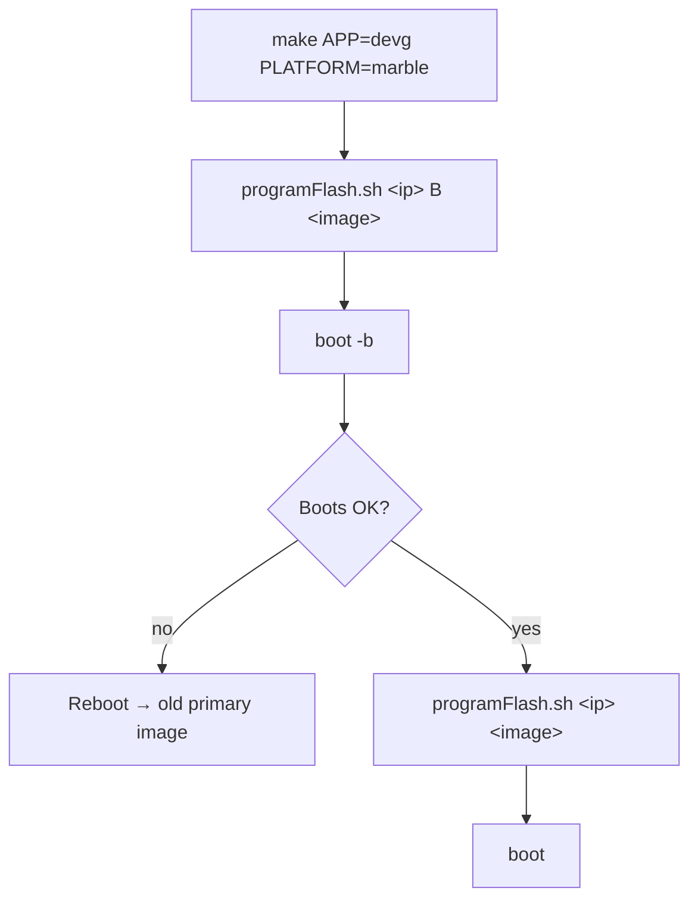

# How to Update Firmware

> [!NOTE]
> **dual-evg docs:** [Overview](README.md) · [Hardware](Hardware.md) · [Firmware](Firmware.md) · [Updating Firmware](HowtoUpdateFirmware.md) · [Bringing Up a New Board](BringingUpNewBoard.md)<br>
> **Related projects:** [EPICS support module ↗](https://git.als.lbl.gov/accelerator-controls/epics/iocs/DualEventGeneratorSupport/-/blob/HEAD/documentation/README.md) · [Timing IOC ↗](https://git.als.lbl.gov/accelerator-controls/epics/iocs/siocDualTiming/-/blob/HEAD/documentation/README.md)

This procedure builds a bootable image containing FPGA gateware and µBlaze software, then writes it to flash memory. The new image is first tested from the **alternate** (`B`) boot slot and copied to the **primary** (`A`) slot only once it has booted successfully.

**Prerequisites**

- A clone of the `dual-evg` repository with submodules (`git submodule update --init`).
- Vivado and Vitis 2020.2.2 on `PATH`. See [Building](Firmware.md#building).
- A `tftp` client, and network access to the event generator.
- A suitable application already running on the board. For a new board, see [Bringing Up a New Board](BringingUpNewBoard.md) first.

---

## Part 1 — Build the image

#### 1. Build

From the repository top:

```sh
make CROSS_COMPILE=<vitis>/gnu/microblaze/lin/bin/mb- \
     APP=devg PLATFORM=marble EVIO_TYPE=evio
```

Gateware, software, and the merged image are all rebuilt as needed. Use `EVIO_TYPE=evio_trig_nibble_reversed` for EVIO cards with the trigger inputs in reversed nibble order.

#### 2. Locate the image

The bootable image is:

```
software/app/devg/devg_marble.<git-hash>.bit
```

The commands below call it `IMAGE`:

```sh
IMAGE=$PWD/software/app/devg/devg_marble.<git-hash>.bit
```

---

## Part 2 — Program the flash

Run these from `software/scripts`, or anywhere with `programFlash.sh` on hand. The examples use the address `131.243.93.169`; substitute the address of your unit.

#### 3. Write the *alternate* boot image

```sh
sh programFlash.sh 131.243.93.169 B "$IMAGE"
```

This uses TFTP to transfer the image to `DEVG_B.bit` in flash, then reads it back to confirm the transfer and write succeeded. Look for **Flash write succeeded.**

#### 4. Boot the alternate image

From the FPGA console:

```
boot -b
```

Answer `y` at the prompt.

**Or:** hold **Display**, then press and hold **Reboot/Recovery** for more than two seconds.

#### 5. Verify

- ✅ **Boots and starts properly** → continue to step 6.
- ❌ **Doesn't** → press and hold **Reboot/Recovery** for more than two seconds, or power cycle, to reboot the old firmware from the primary image.

#### 6. Write the *primary* boot image

```sh
sh programFlash.sh 131.243.93.169 "$IMAGE"
```

Transfers the image to `DEVG_A.bit` and verifies it by read-back.

#### 7. Reboot into the new primary image

Any of:

- Run `boot` (no arguments) from the FPGA console and answer `y`.
- Press and hold **Reboot/Recovery** for more than two seconds.
- Power cycle the unit.

---

## Quick reference



> [!TIP]
> If `FPGA_IP_ADDRESS` is set in the environment, `programFlash.sh` uses it when no address is given.
